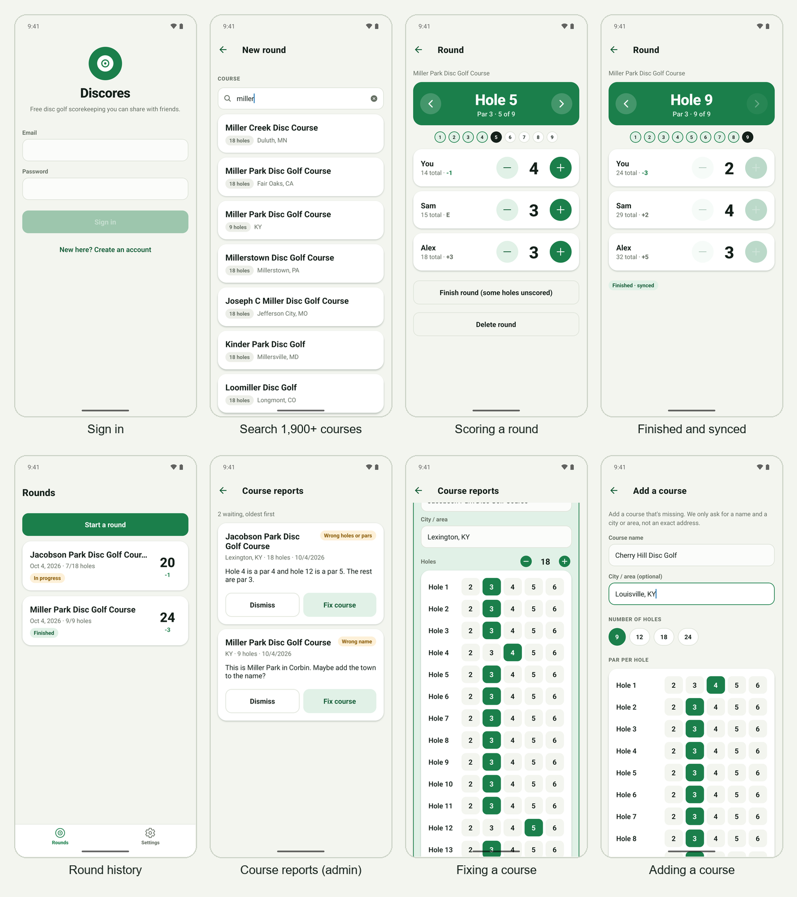
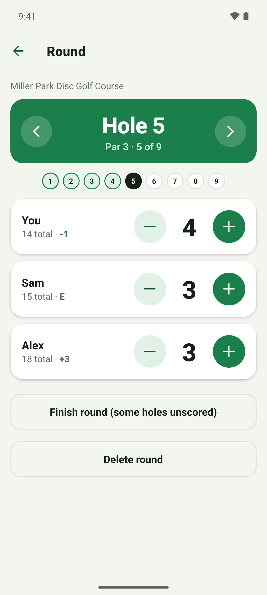
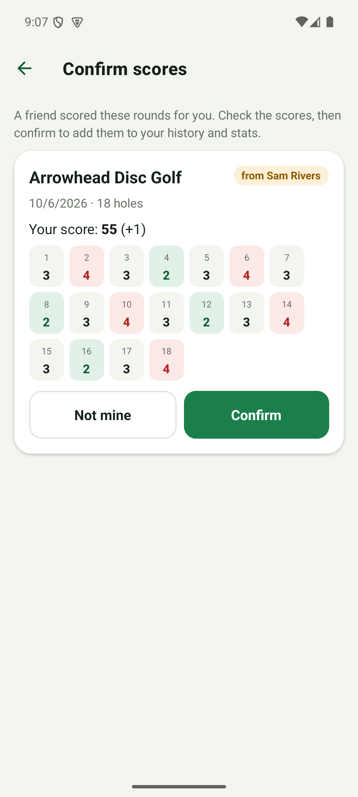
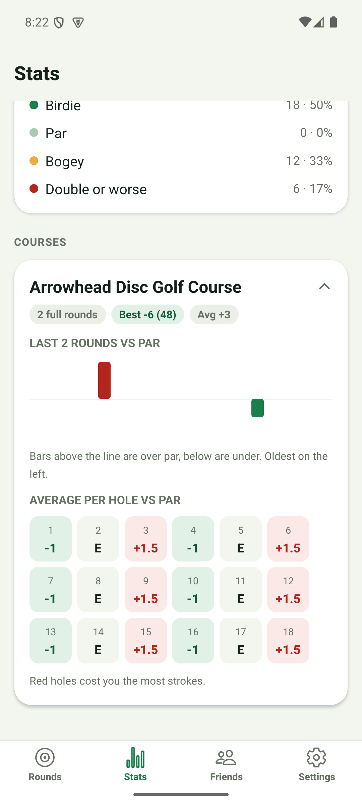

# Discores

Free disc golf scorecard for iOS and Android. Keep score hole by hole on the course, even with no signal, share rounds with friends, and look back at your history and stats.



<p>  </p>

Scoring a round, confirming a round a friend scored for you, and stats. More screenshots are in [docs/screenshots](docs/screenshots).

## Why it exists

Disc golf is played outdoors, often with weak or no signal, and a round usually has several people to keep score for. Discores records every hole on the device first and syncs when a connection returns, so a round is never lost on the course. Shared rounds only appear in a player's history after that player confirms their own scores, so each person's stats stay accurate.

## Features

- **Scoring that works offline.** Rounds, players and scores are written to on-device SQLite first and synced when a connection returns.
- **Your account keeps your rounds.** Signed in, a reinstall or a new phone restores your full history from the server (`pull_my_rounds`), and deleting a round deletes it on every device.
- **Course search** across about 1,960 US courses imported from OpenStreetMap and Overture Maps data; users can add a course or report a problem with one.
- **Friends and shared rounds.** Add friends by code, QR code, invite link, exact email (opt-in) or `@username`. When a round with registered players finishes, each player confirms their own scores before it appears in their history.
- **History and stats** per player.
- **Sign in** with email, Apple or Google.
- **Safety and privacy tools.** Report or block people, an admin review queue for reports and course problems, and in-app account deletion (including Sign in with Apple token revocation).

## Stack

- **App:** Expo SDK 57, React Native 0.86, TypeScript, Expo Router, `expo-sqlite`
- **Backend:** [Supabase](https://supabase.com) – Postgres (19 SQL migrations in `supabase/migrations`), Auth, and two Edge Functions (`apple-link`, `delete-account`)
- **Tests:** Jest (`jest-expo`)
- **CI:** GitHub Actions – type check, tests, and a check that the generated legal text and web pages are up to date

## Repository layout

| Path | What is there |
| --- | --- |
| `app/` | The Expo app (`src/app` routes, `src/domain` scoring and stats, `src/sync` offline sync engine) |
| `supabase/` | Migrations, seed data, Edge Functions, and the course import scripts |
| `docs/` | Setup guide, legal documents, screenshots, store-listing drafts |
| `site/` | Static pages (privacy policy, terms, account deletion) generated from `docs/legal` |

## Running it

You need your own Supabase project. The full walkthrough (migrations, auth providers, course import, Edge Function secrets) is in [docs/SETUP.md](docs/SETUP.md). In short:

```bash
cd app
cp .env.example .env     # set EXPO_PUBLIC_SUPABASE_URL and EXPO_PUBLIC_SUPABASE_ANON_KEY
npm install
npx expo start
```

Checks:

```bash
npm test
npm run typecheck
```

The Jest suite covers scoring, stats, the sync engine, sign-in recovery and invites, display names, and the on-device migrations (fresh install, upgrading a first-release database with its data, a failed step rolling back, repeat runs), the on-device delete queue, the sync engine's delete handling, the restore merge (new device, unsynced edits, server deletes, two devices) and the first-finish-time rule. The SQL is tested for real: `supabase/tests/run.sh` applies every migration to a scratch PostgreSQL database (with stand-ins for Supabase's `auth` schema) and runs the assertions in `supabase/tests/*.test.sql`; CI does the same in a `sql` job. Run it yourself against any throwaway Postgres with `PGHOST`, `PGUSER` and `PGPASSWORD` set, never a real project. The migration tests run on Node's built-in SQLite, so they need Node 22.13 or newer.

## Design decisions

- **Offline-first with idempotent sync.** Ids are generated on the device (UUIDs), every change marks a round dirty, and the server's `sync_round()` upserts it, so a retried push is harmless. Scores are last-write-wins per player and hole.
- **The on-device database is versioned.** `app/src/db/migrations.ts` holds numbered schema steps, run in order inside a transaction and recorded in `PRAGMA user_version`. A step that fails is rolled back and reported instead of ignored, and a step that has shipped is never edited; changes are made by adding the next one. Phones that installed before versioning are recognised (their tables already exist), so they upgrade in place without losing rounds.
- **Deleting a round deletes it on the server, and the owner's scores go with it.** `delete_round()` removes the owner's seat and scores, so they disappear from everyone's view. A friend whose seat the owner recorded and who confirmed it keeps their own scores: the round stays for them without the owner's seat (the same way a round survives its owner deleting their account). Seats nobody has answered are removed, and if nobody is left to keep the round it is deleted. A tombstone (`round_tombstones`) remembers the delete for 90 days so a second device or a late sync cannot bring the round back; older tombstones are cleared by the next delete. On the phone a deleted round is hidden and queued (`pending_delete`) until the server confirms, so deleting works offline.
- **Restoring is a merge, not a copy.** After each push the app calls `pull_my_rounds()` and a pure function (`app/src/sync/restore.ts`, unit tested) decides what to change: restore rounds the phone lacks, drop rounds the server says were deleted, and take newer scores or seats from the server. A round with unsynced edits or a queued delete is left alone until its push goes through. Restoring is read-only on the server, so friends are never asked to confirm a seat again; guest rounds stay on the phone.
- **Round-level conflict rules.** Scores are last-write-wins per hole by `updated_at`. A finished round stays finished and the earliest `finished_at` wins (`least()` in `sync_round`, migration 0019, and the same rule on the phone), so a stale device can neither un-finish a round nor push its finish time later.
- **Confirm before sharing.** A round only shows up in another player's history after they confirm their own scores; declining unlinks them and leaves their name as plain text.
- **Exact-match lookups only.** Friends can be found by code, email or username, but never browsed or searched by name; the three lookups share one rate limit, and a miss does not reveal whether an account exists.
- **Course data from open sources**, with attribution shown in the app; new courses within 400 m of an existing one are skipped on import.
- **Legal text generated from markdown**, and CI fails if the generated files drift from `docs/legal`.

## Limitations

- US course coverage only, and thinner outside big cities.

## License

MIT. See [LICENSE](LICENSE). The legal documents in `docs/legal` are separate documents for the app's users and are not covered by it.
