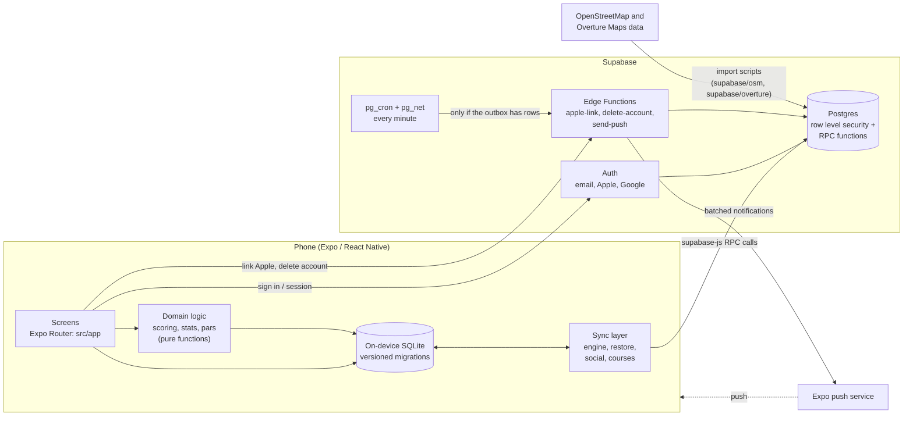
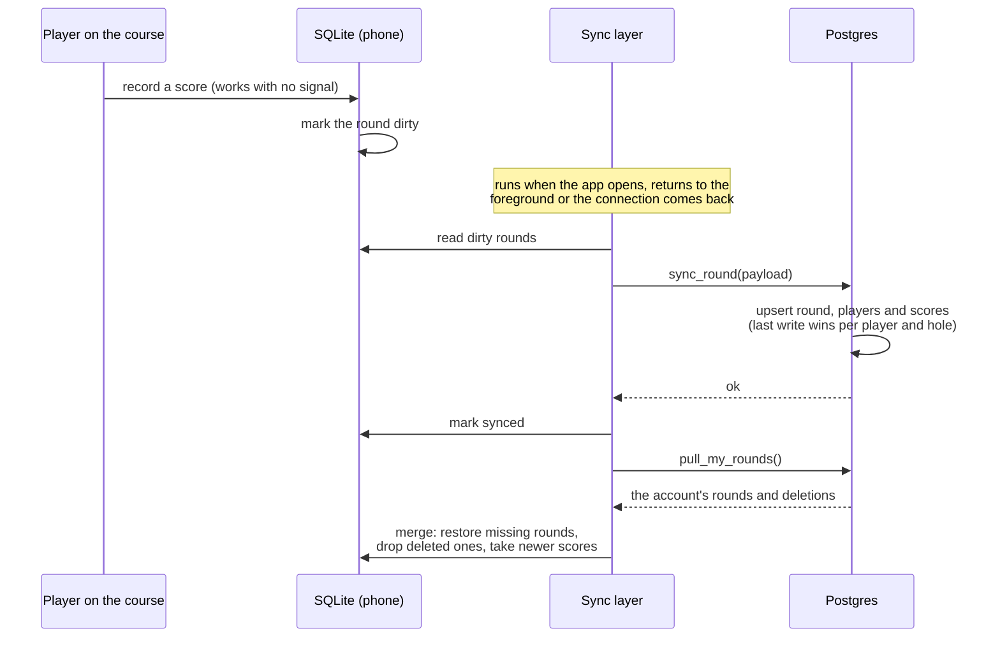
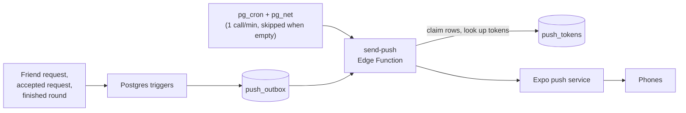
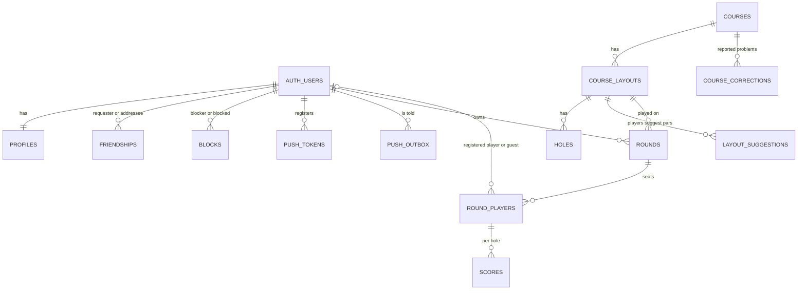

# Discores architecture

Discores is an offline-first disc golf scorecard. The phone is the source of truth while a round is being played; the server is where rounds are shared, confirmed and restored. This page shows how the pieces fit together. The diagrams are Mermaid, which GitHub renders in place.

## System overview

Anything that has rules goes through a Postgres function rather than a plain table write. Syncing a round, adding a friend, responding to a confirmation and adding a course are each a function that checks who is calling and what they may do, and the tables are protected by row level security. The functions are defined in `supabase/migrations`.

## Layers in the app (`app/src`)

| Folder | Role |
| --- | --- |
| `app/` | Screens and navigation (Expo Router): scoring, new round, friends, history, settings, and the admin review queue. |
| `domain/` | Pure functions for scoring, stats and par handling, unit tested with no I/O. |
| `db/` | The on-device SQLite database. Numbered schema steps in `migrations.ts` run in a transaction and are recorded in `PRAGMA user_version`; a failing step is rolled back and reported. |
| `sync/` | Everything that talks to the server: pushing dirty rounds (`engine.ts`), restoring and merging (`restore.ts`), friends (`social.ts`), courses and par suggestions (`courses.ts`, `suggestions.ts`), and admin tools (`admin.ts`). |
| `lib/` | Auth session handling, the Supabase client, invites and deep links, push registration, and shared UI. |

## Offline-first sync

A round is written to SQLite first and marked dirty. Ids are generated on the device, so the server can accept the same change twice without creating duplicates.

Rules that keep this safe:

- **Retries are harmless.** `sync_round()` is an upsert, so a push that was interrupted can simply be sent again.
- **Scores are last-write-wins per player and hole**, by `updated_at`.
- **A finished round stays finished**, and the earliest `finished_at` wins, so a stale phone cannot reopen it.
- **Restoring is a merge, not a copy.** A pure, unit-tested function (`restore.ts`) decides what to add, drop or update.
- **Deleting a round** goes through `delete_round()`, which records a tombstone so other devices drop it too.

## Shared rounds and friends

Friends are found only by exact lookup (friend code, QR code, invite link, exact email if the person opted in, or `@username`), never by browsing. When a round with registered players finishes, each player gets a pending confirmation. The round only appears in their history after they confirm their own scores; declining unlinks them and leaves their name as plain text. Blocking and reporting are built in, with an admin review queue.

## Push notifications

Friend requests, accepted requests and finished rounds write a row to `push_outbox` through Postgres triggers. A scheduler calls the `send-push` Edge Function once a minute, but only when something is waiting.

`send-push` only answers a caller that knows a shared secret (held in Supabase Vault for the scheduler and in the function's environment), claims rows before sending so two overlapping runs cannot send the same notification twice, and releases them if sending fails. The schedule is deliberately not a numbered migration: it is a production switch, thrown by hand after the checklist in [PUSH_GO_LIVE.md](PUSH_GO_LIVE.md).

## Core data model

A simplified view of the main tables, with columns omitted. Every user-owned table hangs off `auth.users`.

Design notes behind the model:

- **A round carries its own holes and pars** (`rounds.pars`), so a later correction to a course never rewrites a round that was already played.
- **A seat is a registered user or a guest.** A guest is just a name; registered players confirm before a round shows in their history.
- **Imported courses start unverified**, with par 3 on every hole. When players edit the pars of a round and finish it, those pars are suggested to the course.
- **Account deletion is complete.** Deleting an account removes the user's data through `ON DELETE CASCADE`, and the `delete-account` Edge Function also revokes the Sign in with Apple token.

## Course data

About 1,960 US courses come from OpenStreetMap and Overture Maps data, loaded by the scripts in `supabase/osm` and `supabase/overture`. Courses within 400 m of an existing one are skipped on import, similar names are matched on a normalised name key, and attribution is shown in the app. Players can also add a course or report a problem with one.

## Testing and CI

Jest covers the domain logic, stats, the sync engine and restore merge, the on-device migrations (fresh install, upgrade with data, a failed step rolling back), sign-in recovery and invites. SQL tests for the server functions live in `supabase/tests`. CI runs the type check and tests on every pull request, and fails if the generated legal pages drift from `docs/legal`.
